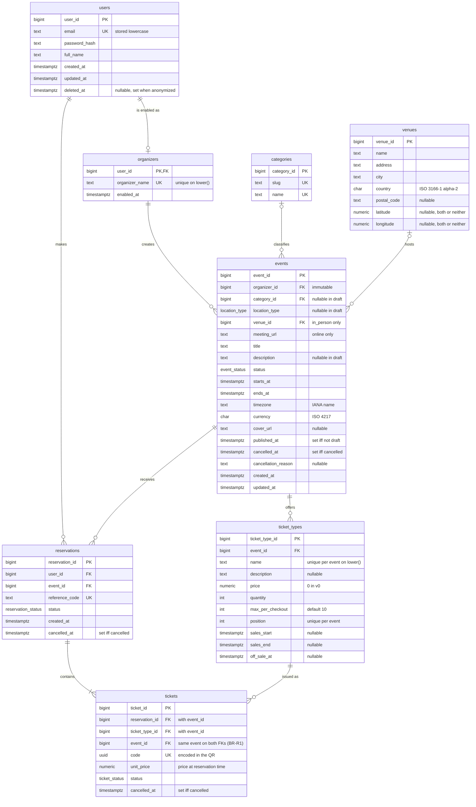

# Design

## ERD

## Normalization check

<!-- For each table: 1NF (atomic values, no repeating groups) → 2NF (no partial dependency on a composite key) → 3NF (no transitive dependency). -->

| Table        | 1NF | 2NF | 3NF | Notes                                                                                                                                                              |
| ------------ | --- | --- | --- | ------------------------------------------------------------------------------------------------------------------------------------------------------------------ |
| users        | ✓   | ✓   | ✓   | Candidate keys: `user_id`, `email`. BCNF.                                                                                                                          |
| organizers   | ✓   | ✓   | ✓   | Keys: `user_id`, `lower(organizer_name)`.                                                                                                                          |
| categories   | ✓   | ✓   | ✓   | Three candidate keys (`category_id`, `slug`, `name`); each determines the row. BCNF.                                                                               |
| venues       | ✓   | ✓   | ~   | `postal_code → city` holds in some countries. Accepted: it's not a reliable dependency worldwide, postal code is optional, and an address table would be overkill. |
| events       | ✓   | ✓   | ✓\* | `status` partly restates `published_at` / `cancelled_at` / `ends_at`. See denormalizations.                                                                        |
| ticket_types | ✓   | ✓   | ✓   | Keys: `ticket_type_id`, `(event_id, lower(name))`, `(event_id, position)`. Currency lives on `events` (D3), so it isn't repeated per type.                         |
| reservations | ✓   | ✓   | ✓   | Per-type quantities aren't stored; they're `COUNT(*)` over tickets (D2), so there's no repeating group and no duplicate count.                                     |
| tickets      | ✓   | ✓   | ✗   | `reservation_id → event_id` is a transitive dependency. Deliberate (BR-R1). See denormalizations.                                                                  |

## Where I denormalize, and why

### `tickets.event_id`

Transitive: `ticket → reservation → event` (also `ticket → ticket_type → event`).

- **Why:** the two composite FKs `(reservation_id, event_id) → reservations` and `(ticket_type_id, event_id) → ticket_types` need it. Sharing one `event_id` column is what enforces BR-R1 declaratively, with no trigger (D2).
- **Drift risk:** none. Both FKs force it to match both parents. This relies on `event_id` being immutable on `reservations` and `ticket_types`.
- **Bonus:** per-event ticket counts don't need a join.

### `events.status`

`draft` means `published_at IS NULL`, `cancelled` means `cancelled_at IS NOT NULL`, and `completed` restates `ends_at < now`.

- **Why:** transitions (BR-E5) need a stored state to compare old and new rows, and queries filter on it directly.
- **Drift guard:** the D5 `CHECK`s stop status and timestamps from contradicting each other. `completed` is the exception: no `CHECK` can see "now", so the stored value can lag until a job sets it (see open question on BR-E10).

### `tickets.status` / `tickets.cancelled_at` vs. `reservations.status` / `reservations.cancelled_at`

In v0, a ticket's status and cancellation time always equal its reservation's, because the only ways to cancel (BR-R5, BR-E9) cancel every ticket of a reservation.

- **Why keep both:** BR-K3 already defines status per ticket. The BR-T3 partial index `ON tickets (ticket_type_id) WHERE status = 'active'` can only filter on the table's own columns. Check-in (`used`, BR-K5) will also be tracked per ticket.
- **Drift guard:** only `reserve_tickets()`, the reservation-cancel path and the D5 cancellation trigger write these columns. A constraint test checks that ticket and reservation statuses agree.

### `events.timezone` (in-person events)

For in-person events, the time zone follows from the venue's location (`event → venue → timezone`).

- **Why on `events`:** online events need a time zone too, and venues don't store one.
- **Risk:** an event's time zone can disagree with its venue's city.
- **Mitigation:** the app pre-fills it from the venue. The database doesn't enforce it.

### Not a denormalization: `tickets.unit_price`

It's a snapshot of the price at reservation time (BR-R7), not a copy of a current fact, so 3NF holds. Its currency comes from `events.currency`, so v1 must either lock `currency` once the event has tickets or copy the currency onto the ticket.

### Pending: `ticket_types` remaining quantity

If the concurrency benchmark (D4, `docs/04-concurrency.md`) favors a stored counter, it gets documented here, maintained by a trigger.
